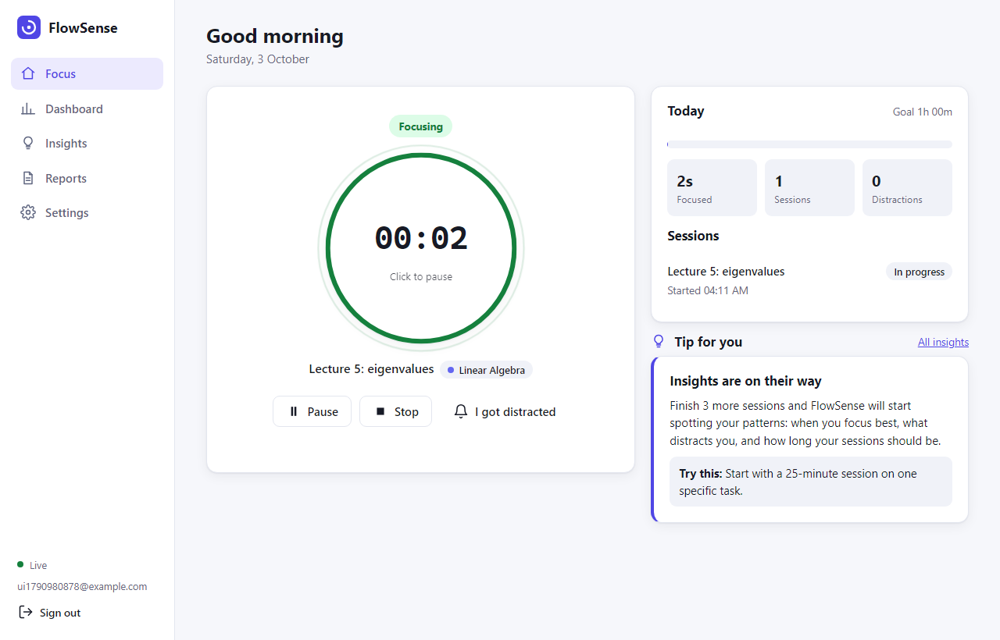
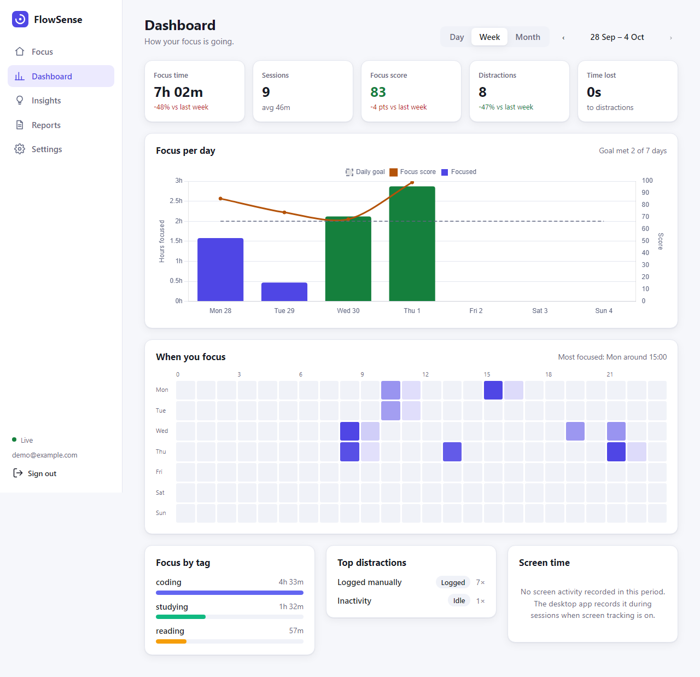
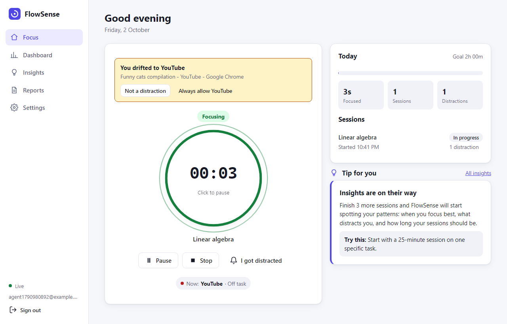
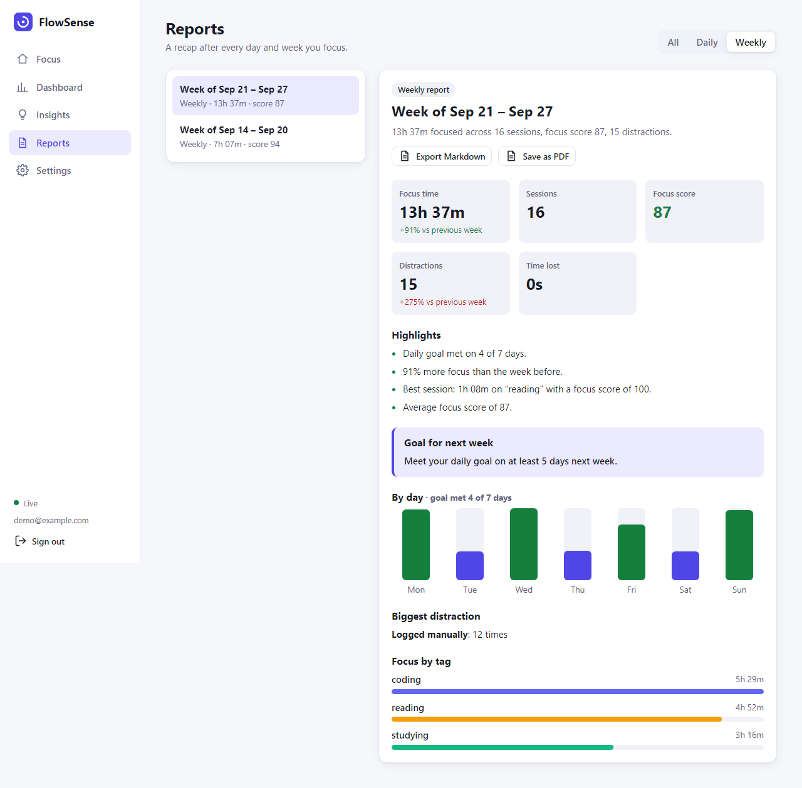
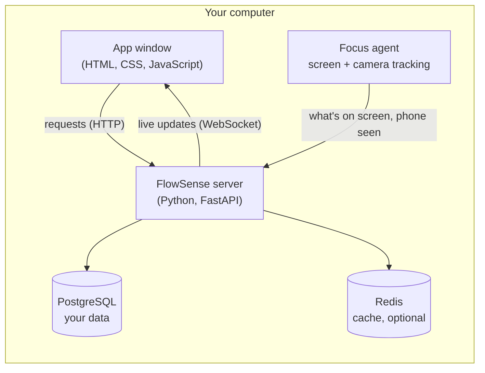

<div align="center">


# FlowSense

**A desktop focus tracker that notices when you drift and helps you build better study and work habits.**

Start a focus session with one click. FlowSense watches which app or site you're on and, if you allow it,
whether you've picked up your phone. It nudges you back when you drift, and turns your sessions into a
dashboard, personal tips, and daily and weekly reports.

Everything runs on your own computer. Your data stays in your own database.

</div>

<p align="center">
  
  
</p>

---

## Contents

1. [Features](#features)
2. [How it works](#how-it-works)
3. [Quick start](#quick-start)
4. [Using FlowSense](#using-flowsense)
5. [Privacy](#privacy)
6. [Troubleshooting](#troubleshooting)
7. [For developers](#for-developers)

---

## Features

| | |
|---|---|
| **One-click focus sessions** | Start, pause, resume and stop with one button (or the Space key). Long breaks automatically start a fresh session. |
| **Screen tracking** | Knows if you're on Coursera, VS Code or a lecture on YouTube (on task) or on Instagram, Netflix or a random video (off task). After a short grace period it nudges you back. |
| **Phone detection** | Optional. Uses your webcam to notice when you pick up your phone, without confusing it with looking down to write notes. |
| **Focus score** | Each session gets a 0–100 score based on distractions and breaks. |
| **Dashboard** | Focus per day, your best hours, focus by subject, top distractions, and screen time, by day, week or month. |
| **Insights** | Personal tips backed by your own data, such as *"Distractions climb after about 45 minutes. Try 40-minute sessions."* |
| **Reports** | A recap after every day and week, with highlights and one goal to work on. Export to Markdown or PDF. |
| **Made for you** | Tags for subjects or projects, your own allow and block rules, a daily goal, and light and dark themes. |

<p align="center">
  
  
</p>

---

## How it works



- The **app window** is what you click and read.
- The **focus agent** runs in the background during a session. Once a second it checks which window is in
  front and, if camera tracking is on, looks for a phone. It only reports small facts such as
  "VS Code, on task" or "phone in use".
- The **server** stores everything, decides what counts as a distraction, and calculates your scores,
  dashboard, insights and reports. It pushes changes to the window instantly.
- **PostgreSQL** is the database. **Redis** is an optional speed-up.

---

## Quick start

These steps are for **Windows**. macOS and Linux work the same way; use `python3.13 -m venv .venv` and `source .venv/bin/activate`.

### What you need

- [Python 3.13](https://www.python.org/downloads/windows/) (3.12 also works; 3.14 is not supported yet).
  On Windows you can run `winget install Python.Python.3.13`.
- [Docker Desktop](https://www.docker.com/products/docker-desktop/) to run the database
  (or a normal [PostgreSQL 16](https://www.postgresql.org/download/) install, see [below](#running-postgresql-without-docker))

### 1. Get the code

```powershell
git clone https://github.com/Mohdomar1800/FlowSense.git
cd FlowSense
```

### 2. Start the database

```powershell
copy .env.example .env
docker compose up -d postgres redis
```

### 3. Install FlowSense

```powershell
py -3.13 -m venv .venv
.venv\Scripts\activate
pip install -r desktop\requirements.txt
```

`py -3.13` picks Python 3.13 even if you have other versions installed.

### 4. Open the app

```powershell
pythonw desktop\flowsense.py
```

The FlowSense window opens. **Create an account**, then answer three quick setup questions:
your daily goal, your subjects, and whether to use screen and camera tracking. That's it. Press **Start focus**.

> **Want to try it with sample data first?** Run
> `cd backend; alembic upgrade head; python -m scripts.seed_demo_data` and sign in as
> `demo@example.com` / `demo-password`, which has two weeks of history. Add `--reset` later to recreate it
> with history that ends yesterday.

### Optional: install it as a normal app

Build a `FlowSense.exe` and add it to the Start Menu and Desktop (no admin rights needed):

```powershell
pip install pyinstaller==6.11.1
powershell -ExecutionPolicy Bypass -File desktop\packaging\build-windows.ps1
powershell -ExecutionPolicy Bypass -File desktop\packaging\install-windows.ps1
```

Your settings live in `%APPDATA%\FlowSense\config.env` (created on first run with a random secret key) and
logs in `%LOCALAPPDATA%\FlowSense\logs`. Run `FlowSense.exe --check` at any time to test the setup.

> The `.exe` is not code-signed, so Windows **Smart App Control** (on by default on new Windows 11 PCs)
> may block it. If so, keep using `pythonw desktop\flowsense.py`; it is the same app.

### Optional: use it in a browser

`docker compose up --build` runs everything, including the server, in Docker. Open **http://127.0.0.1:8000**.
Screen and phone tracking need the desktop app; everything else works in the browser.

---

## Using FlowSense

### Focus

1. Type what you're working on (optional, but it makes screen tracking smarter) and pick a tag.
2. Press **Start focus** (or the **Space** key). The button becomes a live timer.
3. **Pause** for short breaks. A break longer than your *long break* setting (5 minutes by default) saves
   the session and starts a new one when you come back.
4. Press **Stop** when you're done. You'll see how long you focused and your focus score.

Click any session in **Today** to see its timeline, rename it, change its tag, or delete it.

### When you drift

- **Screen:** after a short grace period (15 seconds by default) on an off-task app or site, you get a desktop
  notification and an alert in the app. If FlowSense got it wrong, click **Not a distraction**, or
  **Always allow** so it never flags that app or site again.
- **Phone:** if the camera sees you using your phone for a few seconds, you get a *"Phone down?"* nudge.
  Writing notes or a phone lying on the desk doesn't count.
- **Away:** five minutes without keyboard or mouse activity is logged as stepping away, unless you're on
  something like a lecture video, where no input is normal.

### Review your progress

- **Dashboard:** your focus by day, week or month, compared with the period before, and a heatmap of the hours you focus best.
- **Insights:** a few specific tips based on your last four weeks. The top one also appears on the Focus screen.
- **Reports:** a recap appears after every day and week you focus. Open one, then **Export Markdown** or **Save as PDF**.

### Settings

Change your timezone, daily goal, break and grace times, tags, and screen-tracking rules
(for example *always allow "discord"*), and choose a light, dark or system theme.
You can also change your password (this signs out other devices) or delete your account and all its data.

---

## Privacy

- **No screenshots.** Screen tracking only uses the name of the app in front and its window title.
- **No video leaves your computer.** Camera frames are analyzed in memory once a second and immediately
  thrown away. The camera is only on during an active session, and Home shows a **Camera on** badge when it is.
- Both trackers are **switched off** whenever no session is running, and each can be turned off in Settings.
- All data is stored in **your own PostgreSQL database**. Passwords are hashed with bcrypt.

---

## Troubleshooting

| Problem | What to do |
|---|---|
| The window says **"Database unavailable"** | Start PostgreSQL: `docker compose up -d postgres redis`, then reopen FlowSense. |
| **"Can't reach the FlowSense server"** in a browser | The server isn't running. Start the desktop app, or `docker compose up`. |
| **"Port 8000 is already used by another program"** | Another app is using port 8000. Close it, or start FlowSense on another port: `pythonw desktop\flowsense.py --url http://127.0.0.1:8010`. |
| No screen alerts | Screen tracking must be on in Settings, and a session must be running (not paused). |
| **"Camera unavailable"** | Another app (Zoom, Teams…) may be using the camera. FlowSense retries automatically. |
| Phone detection seems off | Run `python desktop\camera_check.py` to see what the camera detects, live, for 30 seconds. |
| *"An Application Control policy has blocked this file"* | Smart App Control blocks the unsigned `FlowSense.exe`. Run `pythonw desktop\flowsense.py` instead. |
| macOS: no screen tracking | Allow FlowSense in System Settings → Privacy & Security → Accessibility. |

### Running PostgreSQL without Docker

Docker Desktop itself uses 1–2 GB of memory on Windows. For the lightest setup, install PostgreSQL 16 and run once:

```sql
CREATE ROLE flowsense LOGIN PASSWORD 'choose-a-password';
CREATE DATABASE flowsense OWNER flowsense;
```

Put that password in `%APPDATA%\FlowSense\config.env` (read by the desktop app) and in `.env` (read by the
server when you start it with `uvicorn` or Docker). Redis is optional: set `REDIS_ENABLED=false`.

---

## For developers

### Tech stack

| Part | Technology |
|---|---|
| Server | Python 3.13, FastAPI, Pydantic, SQLAlchemy 2, Alembic migrations, APScheduler |
| Data | PostgreSQL 16; Redis 7 for caching, live-update fan-out (pub/sub) and login rate limiting |
| Frontend | Plain HTML, CSS and JavaScript modules (no framework), Chart.js |
| Desktop | pywebview (native window), Win32 API through ctypes, plyer notifications |
| Vision | OpenCV DNN running YuNet (face) and YOLOX-Nano (phone), both ONNX |
| Quality | pytest (backend + agent), Playwright end-to-end tests, ruff, GitHub Actions |
| Packaging | Docker Compose; PyInstaller for `FlowSense.exe` |

### Project layout

```text
backend/     FastAPI server: api/ (routes), services/ (logic), models/ (tables), schemas/, alembic/ (migrations), tests/
frontend/    the web UI served by the server: index.html, css/, js/ (one module per page)
desktop/     native app: flowsense.py (launcher), agent/ (screen + camera tracking), packaging/, tests/
e2e/         end-to-end tests that drive the real UI in a browser
.github/     CI workflow
```

### Running the server and tests

```powershell
docker compose up -d postgres redis
cd backend
pip install -r requirements-dev.txt
alembic upgrade head
uvicorn app.main:app --reload       # http://127.0.0.1:8000, API docs at /docs
pytest                              # backend tests (uses its own flowsense_test database)
cd ..\desktop; pytest               # desktop agent tests
ruff check backend desktop e2e      # lint
```

End-to-end tests run against a live server (`pip install -r e2e\requirements.txt`, then
`python -m playwright install chromium`): `ui_smoke.py`, `agent_flow.py`, `camera_flow.py`,
`dashboard_smoke.py` and `reports_smoke.py` in `e2e\`. GitHub Actions runs all of the above, builds the Docker
image and the Windows app on every push.

### Measured resource use

| State | CPU | Memory (app process) |
|---|---|---|
| Idle, signed in | 0.1% of one core | ~120 MB |
| Session with screen tracking | 0.1% | ~121 MB |
| Session with screen + camera tracking | ~17% | ~164 MB |

Measured with `python desktop\benchmark.py` on Windows 11. The window's web view adds about 120 MB, and PostgreSQL about 50 MB.
